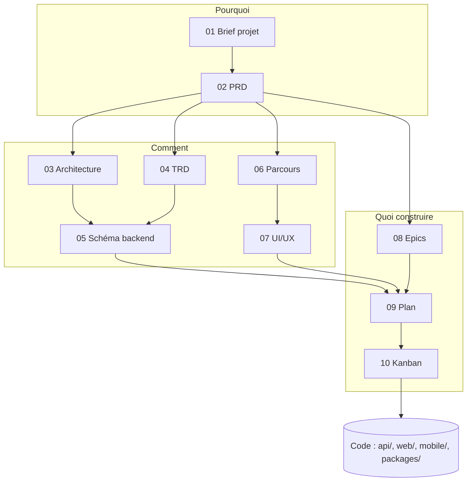

# Index de la documentation

Ce dossier contient les documents de conception de Ludmigo. Chaque document contient la version française, suivie de la traduction anglaise. Les documents se lisent dans l'ordre pour comprendre le projet, ou au cas par cas selon le besoin (voir « Par où commencer »).

## Documents

| N° | Document | Contenu |
| --- | --- | --- |
| 01 | Brief projet | Le contexte : problème, utilisateurs, objectif, périmètre, contraintes, risques et questions ouvertes. |
| 02 | PRD | Les exigences produit : utilisateurs cibles, marché, fonctionnalités, versions et critères d'acceptation. |
| 03 | Architecture | Comment les parties s'assemblent : `api/`, `web/`, `mobile/`, `packages/` et les services externes. |
| 04 | TRD | Les choix techniques : plateformes, hébergement, base de données, sécurité et environnements. |
| 05 | Schéma du backend | Les entités, leurs champs, leurs relations et les règles d'autorisation. |
| 06 | Parcours de l'appli | Les points d'entrée, les écrans et les parcours utilisateur. |
| 07 | Design UI/UX | Le public, le ton, les couleurs, les composants et l'accessibilité. |
| 08 | Epics et user stories | Les epics et leurs stories, avec leurs identifiants `E<epic>-S<story>`. |
| 09 | Plan d'implémentation | L'ordre de construction, étape par étape, avec les points de contrôle. |
| 10 | Kanban | La circulation du travail : colonnes, limites, définitions de prêt et de terminé. |

## Enchaînement des documents

Le schéma se lit de haut en bas : le brief cadre le PRD, le PRD donne les choix techniques, les écrans et les epics, puis le plan d'implémentation et le Kanban organisent la construction du code.

- **Pourquoi** (01, 02) : le problème, les utilisateurs et ce que fait le produit.
- **Comment** (03 à 07) : l'architecture, les choix techniques, les données, les écrans et l'interface.
- **Quoi construire** (08 à 10) : les stories, l'ordre des étapes et le suivi du travail.

## Par où commencer

- **Comprendre le projet** : 01, puis 02.
- **Développer une fonctionnalité** : 08 (la story et ses critères), puis 05 (les données), 06 (les écrans) et 07 (l'interface).
- **Comprendre la technique** : 03, puis 04.
- **Savoir quoi construire ensuite** : 09, puis 10.

## Règles de lecture

- En cas de conflit entre le code et ces documents, signaler l'écart avant de choisir.
- Le suivi du travail (statut, blocages) vit dans Notion ; les stories restent écrites dans le document des epics.

 

  

 

# Documentation index

This folder holds the Ludmigo design documents. Each document contains the French version, followed by the English translation. Read them in order to understand the project, or one by one as needed (see "Where to start").

## Documents

| No. | Document | Contents |
| --- | --- | --- |
| 01 | Project brief | The context: problem, users, goal, scope, constraints, risks and open questions. |
| 02 | PRD | The product requirements: target users, market, features, versions and acceptance criteria. |
| 03 | Architecture | How the parts fit together: `api/`, `web/`, `mobile/`, `packages/` and the external services. |
| 04 | TRD | The technical choices: platforms, hosting, database, security and environments. |
| 05 | Backend schema | The entities, their fields, their relations and the authorisation rules. |
| 06 | App flow | The entry points, the screens and the user flows. |
| 07 | UI/UX design | The audience, tone, colours, components and accessibility. |
| 08 | Epics and user stories | The epics and their stories, with their `E<epic>-S<story>` identifiers. |
| 09 | Implementation plan | The build order, step by step, with checkpoints. |
| 10 | Kanban | How work flows: columns, limits, definitions of ready and done. |

## How the documents fit together

Read the diagram from top to bottom: the brief frames the PRD, the PRD leads to the technical choices, the screens and the epics, then the implementation plan and the Kanban organise the building of the code.

- **Why** (01, 02): the problem, the users and what the product does.
- **How** (03 to 07): the architecture, the technical choices, the data, the screens and the interface.
- **What to build** (08 to 10): the stories, the order of the steps and the tracking of work.

## Where to start

- **Understand the project**: 01, then 02.
- **Build a feature**: 08 (the story and its criteria), then 05 (the data), 06 (the screens) and 07 (the interface).
- **Understand the technology**: 03, then 04.
- **Know what to build next**: 09, then 10.

## Reading rules

- If the code and these documents disagree, report the gap before choosing.
- Work tracking (status, blockers) lives in Notion; the stories stay written in the epics document.
